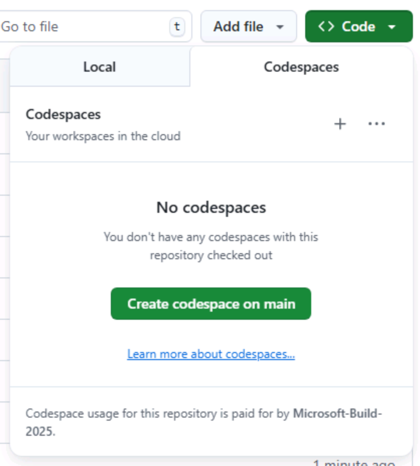

VS Code の演習を始める前に、必要な準備を整えます。Tailspin Toys リポジトリのコピーを作成し、作業用の [codespace][codespaces] を起動して、エディターで GitHub Copilot Chat が使えることを確認します。

## ラボ用リポジトリのセットアップ

コードを作成するためのリポジトリのコピーを用意します。[テンプレート][template-repository]からインスタンスを作成してください。新しいインスタンスにはラボに必要なファイルがすべて含まれており、演習を進める間、このリポジトリを使用します。

1. 新しいブラウザーウィンドウで [Tailspin Toys のテンプレート][tailspin-template]を開きます。
2. ラボ用リポジトリのページで **Use this template** ボタンを選択し、**Create a new repository** を選択して、自分用のリポジトリを作成します。

    

3. GitHub または Microsoft が主催するイベントでワークショップに参加している場合は、メンターの指示に従ってください。それ以外の場合は、GitHub Copilot を利用できる組織に新しいリポジトリを作成できます。

    

4. 作成したリポジトリのパス（**organization-or-user-name/repository-name**）を控えておきます。ラボの後半で参照します。

> [!NOTE]
> **バックログの準備ができました**
>
> テンプレートからリポジトリを作成すると、GitHub issue のバックログが自動的に作成されます。ワークショップではこれらの issue に取り組みます。自分で issue を作成する必要はありません。

## codespace の作成

次に、ラボの演習を行うための codespace を作成します。

[GitHub Codespaces][codespaces] は、ブラウザーから直接コードの作成、実行、デバッグができるクラウドベースの開発環境です。複数のプログラミング言語、拡張機能、ツールに対応した、フル機能の IDE を利用できます。

1. 新しく作成したリポジトリを開きます。
2. 緑色の **Code** ボタンを選択します。

    

3. **Codespaces** タブを選択し、**+** ボタンを選択して新しい Codespace を作成します。

    

codespace の作成には数分かかりますが、サービスを手動でインストールするよりもはるかに短時間で済みます。作成中は、次に紹介する GitHub Copilot の機能を確認してみてください。

> [!CAUTION]
> 今後の演習でこの codespace に戻ります。今はブラウザーのタブで開いたままにしてください。

> [!NOTE]
> このワークショップは、codespace またはローカルの [dev container][dev-containers] で動作するように構成されています。どちらの環境にも、スムーズに作業できるよう必要な前提条件がインストールされています。ローカルで実行する場合は、クローンしたリポジトリを VS Code で開き、プロンプトが表示されたら **Reopen in Container** を選択してください。codespace と同じ dev container が VS Code によって構築されます。

[codespaces]: https://github.com/features/codespaces
[dev-containers]: https://code.visualstudio.com/docs/devcontainers/containers

## GitHub Copilot Chat とエージェントモードの使用

GitHub Copilot Chat のエージェントモードを使うには、IDE に GitHub Copilot Chat 拡張機能がインストールされている必要があります。GitHub Codespace を使っている場合は、すでにインストールされているはずです。

> [!TIP]
> GitHub Copilot Chat 拡張機能がインストールされていない場合は、[Visual Studio Code Marketplace からインストール][copilot-chat-extension]できます。または、Visual Studio Code で拡張機能ビューを開き、**GitHub Copilot Chat** を検索して **Install** を選択します。

拡張機能をインストールした後、GitHub アカウントで認証して有効化する必要がある場合があります。

1. codespace に戻ります。
2. エディターの右側に Copilot Chat が表示されていない場合は、codespace の上部にある **Copilot Chat** アイコンを選択します。
3. Copilot Chat ウィンドウに「Hello world」のようなメッセージを入力し、Enter キーを押します。これで Copilot Chat が有効になります。
4. まだ認証されていない場合は、GitHub アカウントへのサインインを求められます。画面の指示に従って認証してください。

    

5. 認証が完了すると、Copilot Chat ウィンドウが表示されます。

## まとめ

ラボ用リポジトリのコピーを作成できました。また、コードを書き始めるときに使用する codespace の作成も開始しました。

## 次のステップ

Copilot を使い始めましょう。[演習 1 - カスタム指示][next-lesson]に進み、Copilot にプロジェクトの規約を伝えます。

## リソース

- [GitHub Codespaces の概要][codespaces]
- [テンプレートからリポジトリを作成する][template-repository]
- [Codespaces の使用を開始する][codespaces-quickstart]

[tailspin-template]: https://github.com/github-samples/tailspin-toys
[template-repository]: https://docs.github.com/repositories/creating-and-managing-repositories/creating-a-template-repository
[codespaces-quickstart]: https://docs.github.com/codespaces/getting-started/quickstart
[copilot-chat-extension]: https://marketplace.visualstudio.com/items?itemName=GitHub.copilot-chat
[next-lesson]: ../1-custom-instructions/
